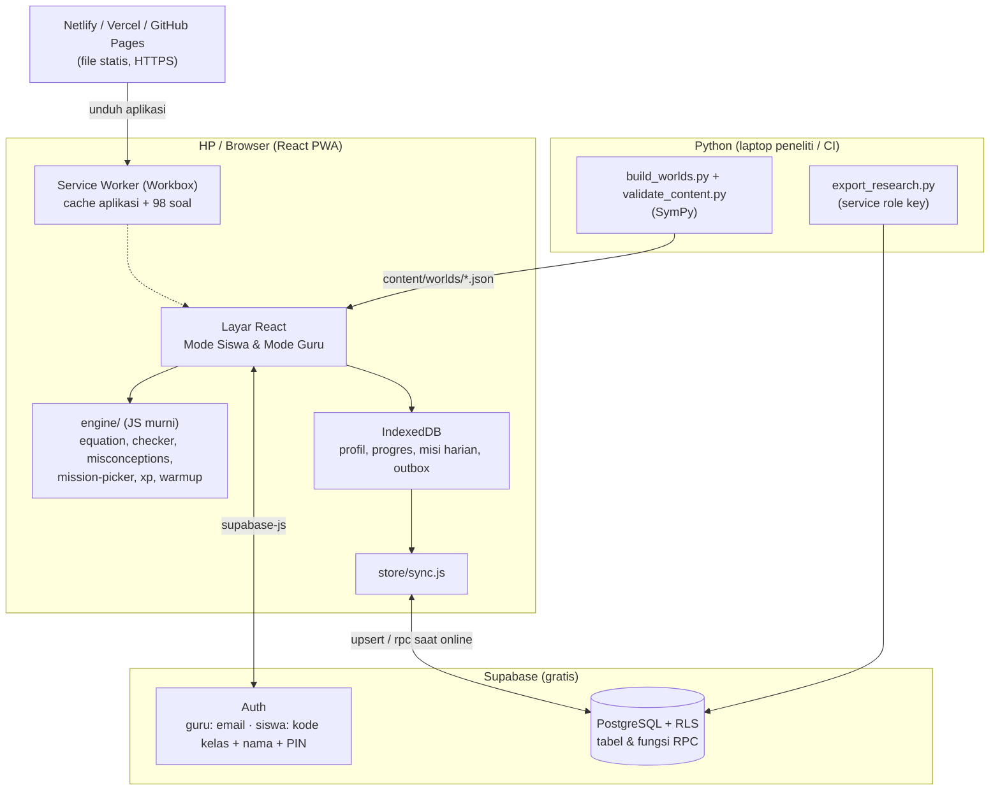
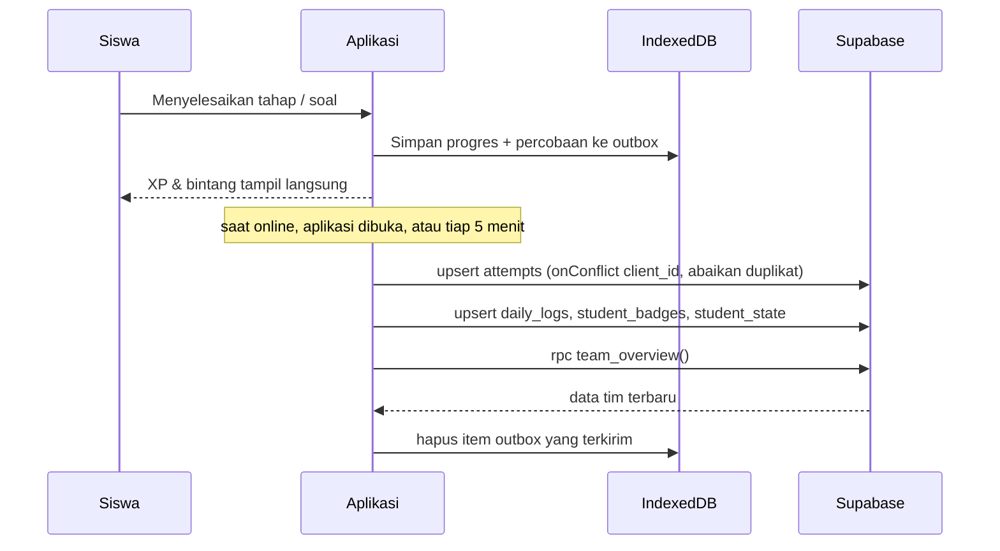

# Arsitektur — MATH-MISSION

## 1. Gambaran umum

MATH-MISSION adalah **PWA offline-first** yang dibangun dengan **React + Vite**. Login dan penyimpanan data di server
memakai **Supabase** (Auth + PostgreSQL + Row Level Security). **Python** dipakai untuk membuat dan memvalidasi bank soal
(SymPy) serta mengekspor data penelitian.

Semua logika belajar (mesin persamaan, pemeriksa jawaban, deteksi miskonsepsi, pemilih misi, XP) berjalan **di perangkat
siswa**, sehingga siswa tetap bisa bermain tanpa internet. Supabase menyimpan akun, kelas, tim, percobaan, dan cadangan
progres. Tidak ada server backend terpisah yang perlu dikelola.



## 2. Tech stack

| Komponen | Pilihan | Alasan |
|---|---|---|
| UI | **React 18 + Vite 6** | Diminta pengguna; ekosistem besar; build cepat |
| Routing | React Router (HashRouter) | Bisa dihosting di mana saja termasuk sub-folder GitHub Pages; aman offline |
| PWA | `vite-plugin-pwa` (Workbox) | Manifest + service worker; install tanpa Play Store/App Store |
| Penyimpanan lokal | IndexedDB (`idb`) | Kapasitas besar, asinkron, bertahan offline |
| Login & database | **Supabase** (`@supabase/supabase-js`) | Auth + Postgres gratis, RLS untuk keamanan per baris, tanpa server sendiri |
| Grafik timbangan | SVG dari komponen React | Tajam di semua layar, ringan |
| Tooling konten | **Python + SymPy** | Kunci & langkah soal dihitung dan dibuktikan secara simbolik |
| Ekspor penelitian | Python (pustaka standar) | CSV + ringkasan per tahap untuk analisis |
| Uji | Vitest (unit), puppeteer-core (uji asap e2e) | Cepat, memakai Chrome/Edge yang terpasang |

Ukuran bundel produksi ± 170 KB gzip (React 54 KB, Supabase 60 KB, aplikasi 53 KB) — memenuhi NFR-02.

## 3. Struktur folder

```
2225250008_Aulia Sifa Maulani Rahayu/      (root repo)
  README.md  PRD.md  CLAUDE.md  netlify.toml  .gitignore  .github/workflows/ci.yml
  docs/                     dokumen perencanaan
  content/
    worlds/world-1..7.json  bank soal (DIHASILKAN, jangan diedit manual)
    tools/build_worlds.py   sumber soal + generator langkah/kunci/petunjuk
    tools/validate_content.py
    tools/export_research.py
    requirements.txt
  supabase/
    migrations/0001_init.sql  skema, RLS, trigger, fungsi RPC
  frontend/
    index.html  vite.config.js  package.json  .env.example
    public/     favicon.svg, icons/ (PNG PWA)
    tools/make_icons.py
    e2e/smoke.cjs            uji asap di viewport HP
    tests/                   uji Vitest
    src/
      main.jsx  App.jsx       titik masuk & routing per peran
      state.js                state + hook useAppState()
      content.js              memuat ../content/worlds/*.json
      game.js                 misi harian, XP, bintang, lencana, pencatatan percobaan
      pwa.js  sound.js
      lib/supabase.js  lib/auth.js
      store/db.js  store/sync.js
      engine/                 logika murni (tanpa React/DOM)
      components/             ui.jsx, Keypad.jsx, BalanceScale.jsx
      screens/                Auth, Student, Team, Profile, Teacher, problem/{Problem,stages}.jsx
      styles/tailwind.css, main.css
```

## 4. Frontend

### 4.1 Rute dan peran
| Rute | Layar | Peran |
|---|---|---|
| `#/welcome` | Pilih **Mode Siswa** atau **Mode Guru** | publik |
| `#/siswa` | Daftar / masuk siswa (atau mode demo bila Supabase belum diatur) | publik |
| `#/guru` | Daftar / masuk guru | publik |
| `#/home` | Beranda misi harian (FR-03) | siswa |
| `#/warmup` | Pemanasan (FR-12) | siswa |
| `#/map`, `#/world/:n` | Mission Map & halaman misi: tujuan, materi singkat, contoh, latihan (FR-04) | siswa |
| `#/tutor` | AI Math Tutor umum; dari layar soal lewat tombol 🤖 (lembar bawah, tahu soalnya) | siswa |
| `#/play/:id?m=main\|team` | Layar soal bertahap (FR-05–FR-11) | siswa |
| `#/result` | Hasil: bintang, XP, lencana | siswa |
| `#/team` | Tim & leaderboard (FR-14, FR-15) | siswa |
| `#/profile` | Statistik, lencana, hapus akun | siswa |
| `#/settings` | Pengaturan: avatar, musik, efek suara, tema, info aplikasi, keluar (FR-20) | siswa & guru |
| `#/reset-password` | Buat password baru dari tautan email (FR-23) | guru |
| `#/teacher` | Daftar & buat kelas | guru |
| `#/teacher/class/:id` | Dashboard kelas (FR-16, FR-19) | guru |
| `#/install`, `#/about` | Panduan pasang, privasi | semua |

`RequireRole` di `App.jsx` mengarahkan pengguna ke beranda perannya bila membuka rute peran lain.

### 4.2 Mesin persamaan (`src/engine/equation.js`)
- **Representasi**: AST (`num`, `x`, `add`, `sub`, `mul`, `div`, `neg`, `grp`) dan bentuk linear `{a, b}` = a·x + b
  dengan `Fraction` (bilangan rasional tepat, tanpa floating point).
- **Parser** menerima `3x`, `3*x`, `x/4`, `2(x+3)`, `−x`, `25.000` (titik ribuan), `2,5` (koma desimal).
- **Operasi kedua ruas** `applyOp(eq, op, value)` untuk `add | sub | mul | div | expand | swap`; mengembalikan bentuk
  antara (mis. `3x − 5 + 5 = 16 + 5`) dan hasil sederhana (`3x = 21`).
- **`nextStep(eq)`** memakai aturan yang sama dengan generator Python (`gen_steps`) untuk petunjuk dinamis.
- **Setara** bila himpunan penyelesaiannya sama, sehingga langkah siswa yang benar tetapi berbeda dari kunci tetap diterima.

### 4.3 Pemeriksa & miskonsepsi
- `checker.js`: status `invalid | wrong | same | ok | solved` untuk tiap baris langkah siswa; `tiltFor()` menghitung arah
  miring timbangan untuk persamaan yang salah.
- `misconceptions.js`: dari persamaan sebelumnya dibangun kandidat langkah salah M1–M6; jika penyelesaian siswa sama
  dengan salah satu kandidat, kode miskonsepsi dan umpan baliknya ditampilkan. Pola khusus soal (`wrong_step`,
  `wrong_answer`) dicek lebih dulu. M7 dan M8 dideteksi di tahap Modelkan dan Periksa.

### 4.4 Penyimpanan lokal (IndexedDB `math-mission`)
| Store | Isi |
|---|---|
| `kv` | `profile`, `stats` (XP, streak, lencana, penghitung), `settings`, `teamCache` |
| `progress` | per soal: `done`, `bestStars`, `plays` |
| `daily` | misi harian per tanggal |
| `outbox` | percobaan yang belum terkirim ke Supabase |

Saat keluar akun atau saat akun lain masuk di HP yang sama, data lokal dihapus agar tidak tercampur.

### 4.5 Strategi cache (Workbox)
| Sumber | Strategi |
|---|---|
| HTML, JS, CSS, ikon, **seluruh bank soal** (dibundel) | Precache saat install |
| Google Fonts | CacheFirst, 1 tahun |
| Supabase | Tidak di-cache oleh SW; data tim terakhir disimpan di `teamCache` |

Versi baru memunculkan toast "Versi baru tersedia — Muat ulang", tidak memaksa reload saat siswa sedang mengerjakan soal.

### 4.6 Sinkronisasi offline

- `client_id` (UUID) membuat pengiriman ulang tidak menggandakan data.
- Trigger `clamp_attempt` di database membatasi XP per tahap dan menetapkan `student_id = auth.uid()`, sehingga XP tidak
  bisa dicurangi dari klien.
- Saat siswa masuk di HP baru, `student_state` diambil dan digabung (nilai terbaik) dengan data lokal.

## 5. Supabase
- Skema lengkap: [`supabase/migrations/0001_init.sql`](../supabase/migrations/0001_init.sql). Model data:
  [DATA_MODEL.md](DATA_MODEL.md). Fungsi yang dipanggil aplikasi: [API_SPEC.md](API_SPEC.md).
- **Login guru**: email + password (Supabase Auth).
- **Login siswa**: kode kelas + nama panggilan + PIN 6 angka. Aplikasi membuat alamat sintetis
  `<kode>.<nama>-<hash>@siswa.math-mission.app` yang tidak pernah menerima email, sehingga siswa tidak perlu email asli.
  Konfirmasi email di Supabase **wajib dimatikan** (lihat DEPLOYMENT).
- Profil dibuat otomatis oleh trigger `handle_new_user` dari metadata pendaftaran (`role`, `class_code`, `nickname`).
- **RLS**: siswa hanya membaca/menulis datanya sendiri; guru hanya melihat kelas dan siswanya; perubahan oleh guru
  (tim, kode penelitian, hapus siswa) lewat fungsi `security definer` yang memeriksa kepemilikan kelas.

## 6. Tooling Python
| Skrip | Fungsi |
|---|---|
| `content/tools/build_worlds.py` | Sumber soal ringkas → JSON lengkap; langkah, kunci, petunjuk, pilihan penjelasan, pola miskonsepsi dihitung dengan SymPy |
| `content/tools/validate_content.py` | Validasi skema & kebenaran simbolik seluruh soal (CONTENT_BANK §4); dipakai di CI |
| `content/tools/export_research.py` | Ekspor CSV anonim + ringkasan tingkat kesalahan & waktu per tahap |
| `frontend/tools/make_icons.py` | Membuat ikon PWA PNG tanpa pustaka tambahan |

## 7. Variabel lingkungan
| Variabel | Di mana | Contoh |
|---|---|---|
| `VITE_SUPABASE_URL` | `frontend/.env`, Netlify | `https://abcd.supabase.co` |
| `VITE_SUPABASE_ANON_KEY` | `frontend/.env`, Netlify | kunci `anon` (aman di frontend karena RLS) |
| `VITE_STUDENT_EMAIL_DOMAIN` | opsional | `siswa.math-mission.app` |
| `SUPABASE_URL`, `SUPABASE_SERVICE_ROLE_KEY` | hanya laptop peneliti | untuk `export_research.py`, **jangan** di-commit |

Tanpa `VITE_SUPABASE_*`, aplikasi tetap berjalan dalam **mode demo siswa** (data hanya di HP, tanpa tim dan Mode Guru).

## AI Math Tutor

```mermaid
flowchart LR
    UI["TutorChat.jsx"] -->|aiStatus() = ready| INV["supabase.functions.invoke('ai-tutor')"]
    INV --> EF["Edge Function ai-tutor<br/>cek siswa + kelas.ai_tutor + kuota harian<br/>samarkan email/nomor"]
    EF -->|"store:false, tanpa identitas"| GEM["Gemini Interactions API"]
    EF -->|service role| DB[("ai_chat_sessions / ai_chat_messages")]
    UI -->|"demo / offline / mati / kuota / error"| FB["engine/tutorFallback.js<br/>(tutor bawaan, di HP)"]
    UI -->|mode bimbingan| GUARD["leaksAnswer(): balasan yang menyebut x = jawaban diganti petunjuk"]
```

- Pembahasan lengkap (`mode: full`) hanya bila siswa sudah mencoba (tahap sebelumnya selesai atau sudah ada jawaban
  di tahap ini) **dan** menekan "Minta pembahasan lengkap". Di layar soal hal ini menambah `hintsUsed` +3 sehingga soal
  selesai dengan 1 bintang dan tanpa bonus "tanpa petunjuk" (aturan XP tidak diubah).
- Musik latar dan tutor tidak menambah dependensi baru (bundel ± 71 KB gzip untuk kode aplikasi).
