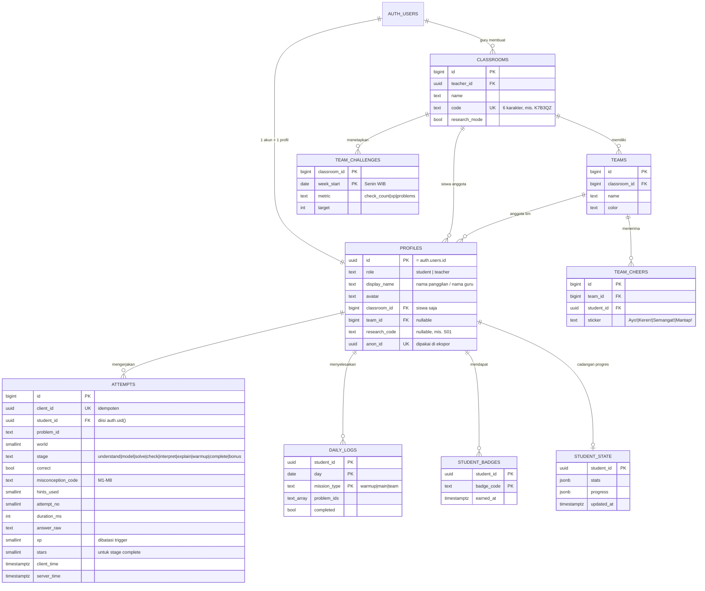

# Model Data — MATH-MISSION (Supabase / PostgreSQL)

Soal **tidak** disimpan di database. Sumbernya file JSON di `content/worlds/` yang dibundel ke aplikasi, dan dirujuk lewat
`problem_id` (mis. `w6-p05`). Database menyimpan akun, kelas, tim, percobaan, dan cadangan progres.
Definisi lengkap: [`supabase/migrations/0001_init.sql`](../supabase/migrations/0001_init.sql).

## ERD

## Catatan desain
- `ATTEMPTS` dicatat **per tahap** sehingga guru dan peneliti tahu tahap mana yang paling sulit (pertanyaan penelitian
  tentang beban kognitif per tahap). Tahap `complete` menyimpan bintang soal; `bonus` menyimpan XP misi harian.
- Nama panggilan unik per kelas (indeks `lower(display_name)` untuk siswa).
- XP dan leaderboard dihitung dari `ATTEMPTS` di server (`class_leaderboard`), bukan angka bebas dari klien.
- Siswa hanya boleh mengubah kolom `display_name` dan `avatar` (hak akses per kolom).
- Menghapus siswa = menghapus baris `auth.users`; semua datanya ikut terhapus (cascade). Lihat
  [PRIVACY_ETHICS.md](PRIVACY_ETHICS.md).
- `research_mode` pada kelas mengizinkan ekspor data anonim (`export_attempts`).

## Row Level Security (ringkas)
| Tabel | Siswa | Guru |
|---|---|---|
| `profiles` | baca & ubah nama/avatar diri sendiri | baca siswa di kelasnya |
| `classrooms` | baca kelasnya | kelola kelasnya (buat lewat RPC) |
| `teams` | baca tim di kelasnya | kelola |
| `attempts` | tambah & baca miliknya | baca milik siswanya |
| `daily_logs`, `student_badges` | kelola miliknya | baca |
| `student_state` | kelola miliknya | — |
| `team_challenges` | baca kelasnya | kelola |
| `team_cheers` | kirim & baca untuk timnya | baca |

## Struktur lokal (IndexedDB)
Lihat [ARCHITECTURE.md §4.4](ARCHITECTURE.md#44-penyimpanan-lokal-indexeddb-math-mission). Objek di `outbox` memakai
kolom yang sama dengan `attempts` (tanpa `id`, `student_id`, `server_time`).
