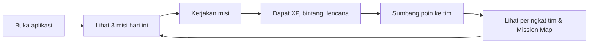

# Desain Game — MATH-MISSION

## 1. Konsep inti
Siswa adalah **Agen Muda** di markas **MATH-MISSION**. Setiap hari markas menerima laporan masalah dari warga
Kota Ruas (kota fiktif). Masalah hanya bisa dipecahkan dengan menemukan nilai **Kotak Misteri** (variabel).
Pemandu siswa adalah robot kecil bernama **Seimbang** yang membawa timbangan.

Lingkaran inti (core loop):

## 2. Misi harian (FR-03)

Setiap hari pukul 00.00 waktu perangkat, 3 misi baru dibuat oleh `mission-picker.js` berdasarkan progres siswa.

| Misi | Isi | Durasi | XP |
|---|---|---|---|
| **Pemanasan** | 5 soal cepat operasi bilangan bulat / satu langkah PLSV | ± 2 menit | 10 |
| **Misi Utama** | 1 masalah PBL dari misi aktif, alur 4 tahap | ± 7–10 menit | 30 (+10 bila tanpa petunjuk) |
| **Tantangan Tim** | 2 soal dari misi yang sudah dibuka; poinnya masuk ke target tim minggu ini | ± 5 menit | 20 |

Aturan pemilihan:
- Misi Utama diambil dari misi aktif, soal yang belum dikerjakan dengan level terendah.
- Jika siswa gagal di tahap yang sama 2 hari berturut-turut, Pemanasan berikutnya berisi soal yang melatih tahap itu
  (mis. soal cepat perubahan tanda).
- Siswa boleh mengerjakan misi tambahan dari Mission Map kapan saja (XP tetap didapat, tapi bonus harian hanya sekali).
- Bonus **Misi Lengkap**: +20 XP bila ketiga misi hari itu selesai.

## 3. Mission Map (FR-04)

Tujuh misi berurutan sesuai ketentuan aplikasi. Di data, nomor misi disimpan di field `world` (1–7) agar skema
database dan ekspor penelitian tidak berubah. Tampilan selalu memakai label "Mission 0N".

| Misi | Nama | Fokus | Bentuk soal | Jumlah |
|---|---|---|---|---|
| 01 | Mengenal PLSV | Bentuk PLSV, ruas, timbangan seimbang | x ± a = b (mode timbangan) | 12 |
| 02 | Memahami Variabel | Variabel, koefisien, konstanta, suku; kalimat → simbol | kalimat → persamaan, ax = b | 13 |
| 03 | Mengenali Informasi dalam Soal | Diketahui, ditanya, informasi tak terpakai | cerita 1 langkah | 10 |
| 04 | Soal Cerita menjadi Persamaan | Memisalkan x dan menyusun persamaan | cerita 2 langkah; tahap Selesaikan **diberikan** | 8 |
| 05 | Menyelesaikan Persamaan | Operasi pada kedua ruas | ax + b = c, x di kedua ruas | 17 |
| 06 | Memahami Perubahan Tanda | Bilangan negatif; **jalan pintas pindah ruas** | negatif, x di kedua ruas | 15 |
| 07 | Tantangan PLSV | Kurung, pecahan, masalah literasi | 2(x + 3) = 18, x/4 + 2 = 5, cerita + tabel | 26 |

- **Unlock berurutan**: misi n terbuka setelah ≥ 70% soal misi n−1 selesai. Syarat memakai **soal selesai**, bukan
  bintang, agar siswa yang sering memakai petunjuk tetap bisa maju. Misi terkunci selalu menampilkan **alasannya**
  ("Selesaikan 3 soal lagi di Mission 02"), jadi siswa tidak terjebak tanpa penjelasan.
- **Setiap misi** punya tujuan pembelajaran (`goal`), materi singkat (`intro`), contoh soal (1 contoh lengkap +
  contoh bertahap), latihan, umpan balik per tahap, dan status (terkunci / sedang dijelajahi / tuntas).
- **Mission 03–04** memakai tahap yang sudah diisi (`given_stages`) agar fokus pada memahami dan memodelkan;
  tahap Periksa tetap wajib (aturan pedagogis 4). Tahap yang diberikan tidak memberi XP.
- **Reward misi tuntas**: saat semua soal sebuah misi selesai, layar hasil menampilkan planet "Mission 0N tuntas!"
  dan siswa mendapat lencana planet misi itu.

## 4. Poin dan progres (FR-13)

### XP per soal
| Aksi | XP |
|---|---|
| Menyelesaikan tahap Pahami | 2 |
| Menyelesaikan tahap Modelkan | 3 |
| Menyelesaikan tahap Selesaikan | 3 |
| Menyelesaikan tahap **Periksa** | 5 |
| Mengisi **Jelaskan ke temanmu** | 5 |

XP terbesar sengaja diberikan pada tahap Periksa dan Jelaskan agar siswa terdorong melakukan cek mandiri dan
penalaran, bukan hanya mengejar jawaban.

### Bintang per soal
- ★ selesai · ★★ selesai dengan ≤ 1 petunjuk · ★★★ tanpa petunjuk dan benar di percobaan pertama tiap tahap.

### Level agen
Level n membutuhkan `50 × n` XP tambahan. Gelar: Agen Pemula (1–4), Agen Penyelidik (5–9), Agen Ahli (10–14),
Agen Master Ruas (15+).

### Petunjuk (FR-08)
Petunjuk tidak mengurangi XP, hanya memengaruhi bintang, agar siswa tidak takut meminta bantuan.
Mengulang soal yang sudah selesai memberi setengah XP tahap (bonus misi tetap utuh). XP per tahap juga dibatasi
oleh trigger database sehingga tidak bisa dicurangi.

### Streak
- Bertambah 1 tiap hari minimal Misi Utama selesai.
- **Tameng Streak**: 1 tameng didapat tiap 7 hari streak; melindungi streak bila siswa absen 1 hari.
- Streak putus tidak menghapus XP atau lencana (tanpa hukuman berat).

### Lencana (contoh)
| Lencana | Syarat |
|---|---|
| Misi Pertama | Menyelesaikan soal pertama |
| Penjaga Timbangan | 10 soal timbangan tanpa membuat timbangan miring |
| Mission 0N Tuntas (7 lencana planet) | Menyelesaikan semua soal sebuah misi |
| Detektif Cerita | 10 tahap Pahami benar di percobaan pertama |
| Pemeriksa Teliti | 20 kali menyelesaikan tahap Periksa |
| Guru Kecil | 15 kali mengisi Jelaskan ke temanmu |
| Tanda Aman | 10 soal berturut-turut tanpa kesalahan tanda (M1) |
| Pantang Menyerah | Menyelesaikan soal setelah ≥ 3 percobaan |
| Seminggu Penuh | Streak 7 hari |
| Pemain Tim | Tim mencapai target Tantangan Tim mingguan |

## 5. Tim dan leaderboard (FR-14, FR-15)

- Guru membagi kelas ke tim 3–5 siswa (atau otomatis acak seimbang). Nama tim dipilih dari daftar nama aman
  (mis. "Tim Elang", "Tim Komodo").
- **Tantangan Tim mingguan**: target kolektif, mis. "Tim menyelesaikan 25 tahap Periksa minggu ini". Bar progres
  tim terlihat semua anggota; anggota yang belum berkontribusi tidak ditandai secara negatif.
- **Leaderboard kelas mingguan**: peringkat tim berdasarkan **rata-rata** XP anggota (adil untuk tim berukuran
  berbeda). Reset setiap Senin 00.00 WIB.
- Tidak ada leaderboard individu antar kelas dan tidak ada chat.
- Pesan semangat terbatas: anggota dapat mengirim stiker siap pakai ("Ayo!", "Keren!", "Semangat!", "Mantap!") ke tim.

## 6. Mode Siswa, Mode Guru, dan mode demo
- Layar awal menampilkan pilihan **Mode Siswa** dan **Mode Guru** (FR-22).
- Mode Siswa membutuhkan akun (kode kelas + nama panggilan + PIN). Progres dicadangkan ke server dan kembali saat
  masuk di HP lain (FR-24).
- Mode Guru: membuat kelas, membagikan kode, membagi tim, menetapkan Tantangan Tim, memantau progres (FR-16).
- **Mode demo** hanya muncul bila aplikasi belum terhubung ke Supabase (mis. saat pengembangan, presentasi, atau
  validasi ahli media):
  - *Mode Siswa demo*: misi harian, Mission Map, XP, dan lencana berjalan lokal; fitur tim tidak tersedia.
  - *Mode Guru demo*: dashboard dengan kelas dan siswa **contoh** (diberi label jelas), bisa membuat kelas, membagi
    tim, mengatur tantangan, dan melihat contoh ekspor CSV. Data contoh mengikuti pola temuan wawancara S01
    (tahap Modelkan & Pahami paling sulit, salah tanda paling sering). Sumber data: `frontend/src/lib/teacherApi.js`.

## 7. Suara dan umpan balik
- Efek suara pendek untuk benar/salah/naik level; dapat dimatikan (FR-20).
- Getar ringan (Vibration API) saat jawaban benar bila didukung perangkat.
- Animasi perayaan hanya di layar hasil, tidak di layar soal.

## 8. Orisinalitas
Semua karakter, kota, nama, ilustrasi, dan musik dibuat orisinal atau memakai aset berlisensi bebas (mis. CC0)
dengan atribusi dicatat di `frontend/public/CREDITS.md`.

## Learning Zone & Challenge Zone

| Aktivitas | XP | Catatan |
|---|---|---|
| Materi Learning Zone tuntas (semua latihan pemahaman benar) | 10 | sekali per materi; lencana **Pembelajar Tekun** setelah 8 materi |
| Soal Challenge Zone benar di percobaan pertama | 3 | sekali per soal |
| Soal Challenge Zone benar setelah mencoba ulang | 1 | sekali per soal |

- Aturan XP ada di `engine/xp.js → ZONE_XP` dan harus sama dengan `clamp_attempt` di `0003_zones.sql`
  (`lesson` ≤ 10, `challenge` ≤ 3). Jawaban salah dicatat dengan XP 0 (data penelitian).
- Lencana **Penantang Advanced**: 10 soal Advanced benar.
- Sesi Challenge menampilkan soal yang belum benar lebih dulu. Setelah 2 kali salah muncul tombol **Lewati dulu**,
  sehingga siswa tidak terjebak. Jawaban akhir tidak pernah ditampilkan (aturan 6); petunjuk muncul setelah 2 kali salah.
- Musik latar ikut berhenti saat mengerjakan latihan materi dan soal tantangan (prinsip koherensi).
